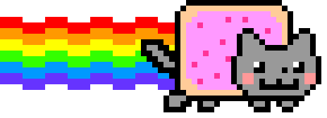

# Daniella Wright's Portfolio!

<br>



<br>

(Mostly) hand-built, framework-free site that shares my experience, research, projects, press, skills, and graphic design work. I plan to keep adding to it as I take on new projects!


<br>

<a href="https://daniellawright.com"></a>

## Project structure

```text
.
├── index.html          # All page content and markup
├── styles.css          # Layout, theme, animation, and responsive rules
├── skills.js           # Expandable skills clusters
├── icon-sounds.js      # Sound effects and mute toggle
├── CNAME               # Custom domain (daniellawright.com)
├── fonts/              # Comfortaa and Happy Children
├── images/             # Photos, icons, skill logos, and artwork
└── sound-effects/      # Short audio clips for link interactions
```

## Run locally

No installation is needed.

```bash
git clone https://github.com/daniellawright/personal-website.git
cd personal-website
```

Open `index.html` in a browser, or serve the folder to test audio and relative paths:

```bash
python -m http.server 8000
# then visit http://localhost:8000
```

## Deployment

The `main` branch is published with GitHub Pages. Pushing to `main` updates [daniellawright.com](https://daniellawright.com).

## Credits

- Design, code, and content by [Daniella Wright Nogueda](https://daniellawright.com), with a few assistant touches by Claude.
- Fonts: [Comfortaa](https://fonts.google.com/specimen/Comfortaa) and Happy Children.
- Skill logos belong to their respective owners.

## License

The code is available for reference and inspiration. Please do not copy the site's content, photos, or artwork without permission.